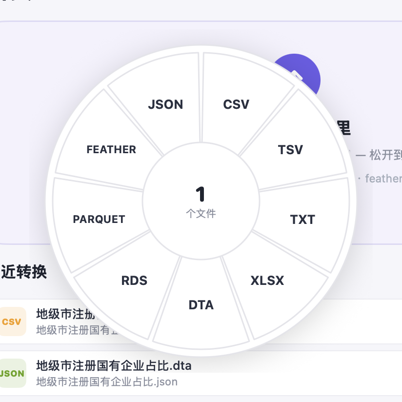
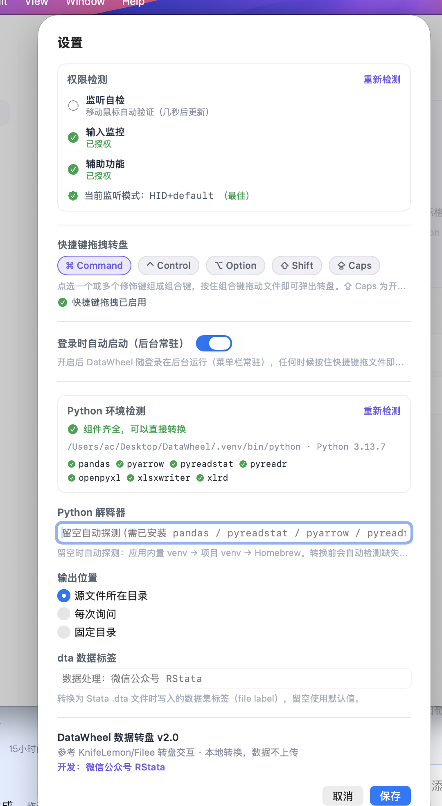

# DataWheel 数据转盘 🎡

<p align="center">
  
</p>

<p align="center">
  <strong>A native macOS data-format converter — drop a file, a wheel pops up, one slice per format</strong><br/>
  Built with native SwiftUI · 100% local, nothing ever leaves your machine · Wheel interaction inspired by <a href="https://github.com/KnifeLemon/Filee/">KnifeLemon/Filee</a>
</p>

<p align="center">
  <a href="README.zh-CN.md">简体中文说明</a>
</p>

<p align="center">
  
  
  
  
</p>

---

## 📸 Preview

**Main window** — drop card + recent conversions + notification stack (keeps the latest 5, dismiss all with one click):

<p align="center">
  
</p>

**The donut wheel** — pops up right under your cursor when you drop a file; release onto a slice to convert. The wheel stays anchored where it appeared, so you can actually aim:

<p align="center">
  
</p>

**Settings hub** — permission self-checks, modifier combos, Python environment detection and the .dta label, all in one place:

<p align="center">
  
</p>

## ✨ Features

### Three ways to convert

| Method | How |
|---|---|
| 🖱 **Window drop** | Drag files anywhere onto the app window — the wheel pops up at your cursor |
| ⌨️ **Global hotkey** | With files selected in **any app** (Finder, Desktop…), **hold the modifier combo and drag** — the wheel appears without ever opening the app. Runs quietly in the background |
| 📋 **Services menu** | Right-click a file → Services → *Convert with DataWheel* |

### Supported formats (9 families · 14 extensions)

| Format | Read | Write | Notes |
|:---|:---:|:---:|:---|
| xlsx / xls | ✅ | ✅ | Rows beyond 1,048,575 are auto-split into `_part1/_part2/…` files (each with the header row) |
| csv / tsv / txt | ✅ | ✅ | txt delimiter auto-sniffed (tab / comma / semicolon / pipe / aligned whitespace); csv output includes a BOM so Chinese opens correctly in Excel |
| dta (Stata) | ✅ | ✅ | Custom dataset label (default: 「数据处理：微信公众号 RStata」), variable names auto-normalized |
| rds / rdata (R) | ✅ | ✅ | Writing falls back to a temp parquet + Rscript `saveRDS` bridge |
| parquet | ✅ | ✅ | — |
| feather / arrow | ✅ | ✅ | — |
| json / jsonl / ndjson | ✅ | ✅ | Line-delimited JSON supported |

### More highlights

- **Batch conversion** — drop/select multiple files at once; conversions run sequentially with a notification stack capped at 5 cards
- **Automatic Python environment detection** — Settings shows the interpreter version and a ✓/✗ for every component; missing packages install with **one click** (PyPI → Tsinghua mirror → `--break-system-packages` fallback chain)
- **Permission self-check center** — Accessibility / Input Monitoring / a live event-stream probe (end-to-end ground truth), auto-refreshing every 2 seconds
- **Menu bar resident** — quick launch from the macOS menu bar; optional *launch at login* for always-on background use
- **Rebuild-proof authorizations** — a stable self-signed certificate (`DataWheel Dev`) keeps TCC grants valid across recompiles
- **Fully local** — every conversion happens on your machine

## ⚙️ Settings

| Setting | Description | Default |
|:---|:---|:---|
| Hotkey drag wheel | Any combination of ⌘ ⌃ ⌥ ⇧ ⇪; hold the combo while dragging a file | ⌘ Command |
| Launch at login | Start in the background at boot (menu bar resident), hotkey always ready | Off |
| Python interpreter | Leave empty to auto-detect: bundled venv → project venv → Homebrew | Empty |
| Output location | Source folder / ask every time / fixed folder | Source folder |
| .dta dataset label | File label written when converting to Stata `.dta` | 数据处理：微信公众号 RStata |

## 🔐 Permissions

| Permission | Required? | Why |
|:---|:---:|:---|
| Accessibility | ✅ Yes | Global listening for the "modifier + drag" gesture |
| Input Monitoring | Strongly recommended | Mounts the event tap at the HID layer so drag events still arrive while the app is in the background or hidden (the same approach as Karabiner / BetterTouchTool), and keeps macOS from repeatedly disabling the tap |

Both grants are handled in one place: **Settings → Permission Check**. Statuses refresh every 2 seconds, and the *Listen self-check* verifies the event stream is genuinely flowing (move your mouse and watch it update) instead of trusting system APIs that can misreport.

## 📦 Installation

### Build from source

```bash
git clone https://github.com/yourname/DataWheel.git
cd DataWheel

# 1. Set up the Python engine environment (either way works)
python3 -m venv .venv && .venv/bin/pip install pandas pyreadstat pyreadr pyarrow openpyxl xlsxwriter xlrd

# 2. Build (swiftc + signing + service registration)
zsh native/build_native.sh

# 3. Install to /Applications
ditto build/DataWheel.app /Applications/DataWheel.app
```

> Requirements for a first build: Xcode or Command Line Tools (for `swiftc`), Python 3.9+.
> The build script handles compile → icon → codesign → LaunchServices/Services registration automatically.

### Engine dependencies

`engine/engine.py` relies on: `pandas` (required), `pyreadstat` (dta), `pyreadr` (rds), `pyarrow` (parquet/feather), `openpyxl` / `xlsxwriter` / `xlrd` (xlsx/xls), and an optional `Rscript` (rds write fallback).
The app detects missing packages automatically and offers **one-click installation** — no manual setup needed.

## 🗂 Project layout

```
DataWheel/
├── native/
│   ├── Sources/            # Native SwiftUI app source
│   │   ├── App.swift           # Entry: window + menu bar resident + Services menu
│   │   ├── HomeView.swift      # Main UI (drop card / recents)
│   │   ├── DonutView.swift     # Floating wheel NSPanel (Filee-style white wedges)
│   │   ├── HotkeyMonitor.swift # CGEventTap global listener (HID layer + 3-level fallback + keep-alive)
│   │   ├── SettingsView.swift  # Settings hub (permissions / hotkey / environment)
│   │   ├── EnvBanner.swift     # Missing-Python-package banner + one-click install
│   │   ├── AppState.swift      # State and conversion job scheduling
│   │   └── Formats.swift       # Format definitions
│   ├── Info.plist
│   └── build_native.sh     # One-command build script
├── engine/
│   └── engine.py           # Python conversion engine (convert / probe / check / install)
├── build/
│   ├── icon.html           # Icon source (HTML rendered → icns)
│   └── icon.icns
├── docs/screenshots/       # README screenshots
└── testdata/               # Sample files in every format
```

## 🛠 Technical notes

- **SwiftUI + AppKit hybrid** — main UI in SwiftUI; the wheel is a standalone `NSPanel` with native `NSDraggingDestination` drag-and-drop, avoiding SwiftUI `onDrop` limitations on macOS
- **HID-layer event listening** — since macOS 15, session-level event taps are focus-filtered and go silent when the app is not frontmost. DataWheel mounts its tap at the HID layer (HID+defaultTap → HID+listenOnly → session fallback), with a 1.5 s health check that rebuilds the tap automatically — the hotkey drag works from the background, hidden, or any state
- **Stable code signing** — the repo includes a self-signed certificate workflow (`build/cert/`) that solves the classic problem of ad-hoc signatures changing CDHash on every build and silently invalidating TCC permissions

## 🙏 Acknowledgments

- Wheel interaction inspired by [KnifeLemon/Filee](https://github.com/KnifeLemon/Filee/)
- Conversion engine powered by [pandas](https://pandas.pydata.org/) / [pyreadstat](https://github.com/Roche/pyreadstat) / [pyreadr](https://github.com/ofajardo/pyreadr) / [pyarrow](https://arrow.apache.org/docs/python/)

---

<p align="center">
  Developed by <a href="https://tidyfriday.cn/">WeChat Official Account · RStata</a> 🎈
</p>
