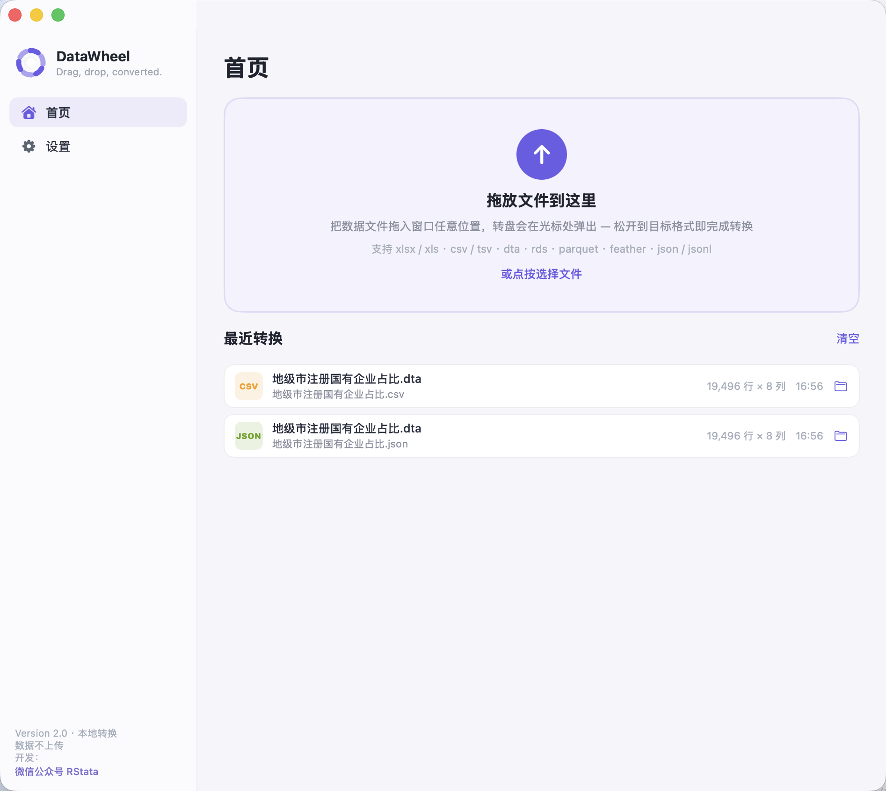
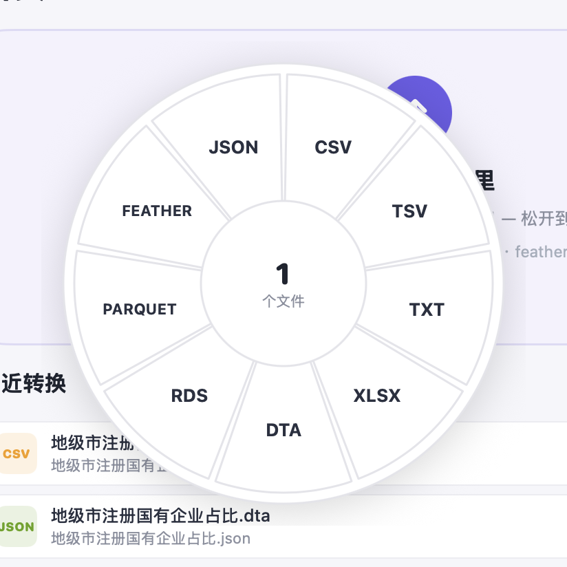
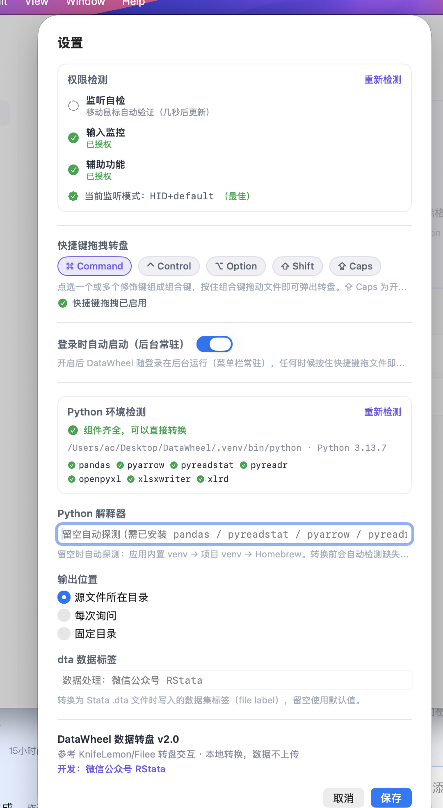

# DataWheel 数据转盘 🎡

<p align="center">
  
</p>

<p align="center">
  <strong>macOS 原生数据格式转换工具 —— 拖上文件，转盘弹出，一格一格式</strong><br/>
  原生 SwiftUI 开发 · 本地转换，数据不上传 · 灵感来自 <a href="https://github.com/KnifeLemon/Filee/">KnifeLemon/Filee</a> 的转盘交互
</p>

<p align="center">
  <a href="README.md">English</a>
</p>

<p align="center">
  
  
  
  
</p>

---

## 📸 预览

**主界面** —— 拖放卡片 + 最近转换 + 通知卡片（最多保留 5 条，可一键全部关闭）：

<p align="center">
  
</p>

**甜甜圈转盘** —— 拖入文件后在光标处弹出，松手到目标扇区即完成转换；转盘锚定在原地，不会跟着鼠标乱跑：

<p align="center">
  
</p>

**设置中心** —— 权限自检、组合快捷键、Python 环境检测、dta 标签一站式配置：

<p align="center">
  
</p>

## ✨ 功能特性

### 三种转换姿势

| 方式 | 操作 |
|---|---|
| 🖱 **窗口拖放** | 把文件拖进应用窗口任意位置，转盘在光标处弹出 |
| ⌨️ **全局快捷键** | 在**任意应用**（Finder/桌面）选中文件后，**按住组合键拖动**文件，转盘即弹出——无需打开应用，后台常驻即可 |
| 📋 **右键服务** | 右键文件 → 服务 → 「用 DataWheel 转换」 |

### 支持格式（9 大类 · 14 种扩展名）

| 格式 | 读取 | 写出 | 说明 |
|:---|:---:|:---:|:---|
| xlsx / xls | ✅ | ✅ | 超过 1,048,575 行自动分片为 `_part1/_part2/…`（每片含表头） |
| csv / tsv / txt | ✅ | ✅ | txt 自动嗅探分隔符（制表符/逗号/分号/竖线/空白对齐）；csv 输出带 BOM，Excel 打开中文不乱码 |
| dta（Stata） | ✅ | ✅ | 自定义数据集标签（默认「数据处理：微信公众号 RStata」），变量名自动规范化 |
| rds / rdata（R） | ✅ | ✅ | 写出经临时 parquet + Rscript `saveRDS` 兜底 |
| parquet | ✅ | ✅ | — |
| feather / arrow | ✅ | ✅ | — |
| json / jsonl / ndjson | ✅ | ✅ | 支持行式 JSON |

### 更多亮点

- **批量转换**：一次拖入/选中多个文件，逐个转换，通知卡片最多保留 5 条
- **Python 环境自动检测**：设置页实时显示解释器版本与逐个组件 ✓/✗，缺失组件**一键安装**（默认源 → 清华镜像 → `--break-system-packages` 三级兜底）
- **权限自检中心**：辅助功能 / 输入监控 / 监听自检（端到端事件流真值）实时状态，2 秒自动刷新
- **菜单栏常驻**：桌面顶部图标快速打开；支持「登录时自动启动」后台常驻
- **重编译授权不失效**：稳定自签名证书（`DataWheel Dev`），TCC 授权跨构建保留
- **完全本地**：所有转换在本机完成，数据不上传

## ⚙️ 设置项

| 设置 | 说明 | 默认值 |
|:---|:---|:---|
| 快捷键拖拽转盘 | ⌘ ⌃ ⌥ ⇧ ⇪ 任意组合，按住组合键拖文件弹出转盘 | ⌘ Command |
| 登录时自动启动 | 开机后台常驻（菜单栏驻留），随时快捷键呼出转盘 | 关 |
| Python 解释器 | 留空自动探测：应用内置 venv → 项目 venv → Homebrew | 留空 |
| 输出位置 | 源文件所在目录 / 每次询问 / 固定目录 | 源文件所在目录 |
| dta 数据标签 | 转换为 Stata `.dta` 时写入的数据集标签（file label） | 数据处理：微信公众号 RStata |

## 🔐 权限说明

| 权限 | 是否必需 | 用途 |
|:---|:---:|:---|
| 辅助功能 | ✅ 必需 | 全局监听「修饰键 + 拖动」手势 |
| 输入监控 | 强烈建议 | 事件 tap 挂载到 HID 层，应用在后台/被隐藏时依然能收到拖拽事件（Karabiner/BetterTouchTool 同款方案），且不会被系统反复禁用 |

两项授权都在 **设置 → 权限检测** 卡片里一站式完成，状态每 2 秒自动刷新；「监听自检」直接验证事件流是否真的在工作（移动鼠标即可看到状态更新），不依赖系统 API 的可能误报。

## 📦 安装

### 方式一：从源码构建

```bash
git clone https://github.com/yourname/DataWheel.git
cd DataWheel

# 1. 构建 Python 引擎环境（任选其一）
python3 -m venv .venv && .venv/bin/pip install pandas pyreadstat pyreadr pyarrow openpyxl xlsxwriter xlrd

# 2. 编译打包（swiftc + 自动签名 + 注册服务）
zsh native/build_native.sh

# 3. 安装到 /Applications
ditto build/DataWheel.app /Applications/DataWheel.app
```

> 首次构建需要：Xcode 或 Command Line Tools（swiftc）、Python 3.9+。
> 构建脚本会自动完成编译 → 图标 → 签名 → LaunchServices/服务菜单注册。

### 依赖组件

转换引擎 `engine/engine.py` 依赖：`pandas`（必需）、`pyreadstat`（dta）、`pyreadr`（rds）、`pyarrow`（parquet/feather）、`openpyxl`/`xlsxwriter`/`xlrd`（xlsx/xls）、`Rscript`（可选，rds 写出兜底）。
缺失时应用会自动检测并支持**一键安装**，无需手动处理。

## 🗂 项目结构

```
DataWheel/
├── native/
│   ├── Sources/            # SwiftUI 原生应用源码
│   │   ├── App.swift           # 入口：窗口 + 菜单栏常驻 + 服务菜单
│   │   ├── HomeView.swift      # 主界面（拖放卡片 / 最近转换）
│   │   ├── DonutView.swift     # 浮动转盘 NSPanel（Filee 式白盘楔形）
│   │   ├── HotkeyMonitor.swift # CGEventTap 全局监听（HID 层 + 三级回退 + 保活）
│   │   ├── SettingsView.swift  # 设置中心（权限检测 / 快捷键 / 环境）
│   │   ├── EnvBanner.swift     # Python 缺组件横幅 + 一键安装
│   │   ├── AppState.swift      # 状态与转换任务调度
│   │   └── Formats.swift       # 格式定义
│   ├── Info.plist
│   └── build_native.sh     # 一键构建脚本
├── engine/
│   └── engine.py           # Python 转换引擎（convert/probe/check/install 子命令）
├── build/
│   ├── icon.html           # 图标源文件（HTML 渲染 → icns）
│   └── icon.icns
├── docs/screenshots/       # README 截图
└── testdata/               # 各格式测试样例
```

## 🛠 技术要点

- **SwiftUI + AppKit 混合**：主界面 SwiftUI；转盘是独立 `NSPanel` + `NSDraggingDestination` 原生拖放，规避 SwiftUI onDrop 在 macOS 上的限制
- **HID 层事件监听**：macOS 15 起 Session 层事件 tap 有「焦点过滤」，应用不在前台就收不到事件；DataWheel 把 tap 挂到 HID 层（HID+defaultTap → HID+listenOnly → Session 三级回退），配 1.5s 健康检查自动重建，保证后台/隐藏状态下的快捷键拖拽始终可用
- **稳定签名**：项目自带自签名证书生成方案（`build/cert/`），解决 ad-hoc 签名 CDHash 每次变化导致 TCC 授权静默失效的经典难题

## 🙏 致谢

- 转盘交互参考 [KnifeLemon/Filee](https://github.com/KnifeLemon/Filee/)
- 转换能力基于 [pandas](https://pandas.pydata.org/) / [pyreadstat](https://github.com/Roche/pyreadstat) / [pyreadr](https://github.com/ofajardo/pyreadr) / [pyarrow](https://arrow.apache.org/docs/python/)

---

<p align="center">
  开发：<a href="https://tidyfriday.cn/">微信公众号 RStata</a> 🎈
</p>
